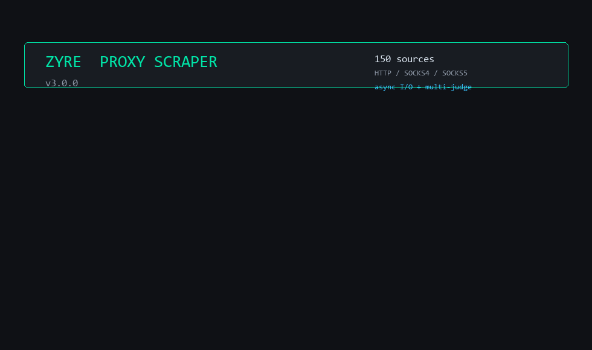

# Zyre Proxy Scraper & Checker

Scrapes and checks free HTTP, SOCKS4, and SOCKS5 proxies from 235 public APIs.

<p align="center">
  
</p>

## Features

- Grabs proxies from 235 live APIs at once (~1.7M unique IPs)
- Multiprocessed checker with custom timeouts and ping limits
- Supports HTTP, HTTPS, SOCKS4, and SOCKS5 (with auth)
- Optional filter to check if proxies are blocked on Discord, Steam, Cloudflare, Twitch, etc.
- Exports working proxies to text files sorted by date

---

## Quickstart

**Windows:**
Run `setup.bat` (sets up venv and installs dependencies automatically).

**Linux / macOS:**
```bash
git clone https://github.com/zyrexdz/proxy-scraper-checker.git
cd proxy-scraper-checker
chmod +x setup.sh && ./setup.sh
```

**Manual:**
```bash
pip install -r requirements.txt
python main.py
```

---

## Presets

| Preset | Timeout | Max Ping | Retries | Note |
| :--- | :--- | :--- | :--- | :--- |
| **ULTIMATE** | 3.0s | 1500ms | 1 | Fast check, lowest ping |
| **BALANCED** | 6.0s | 3500ms | 2 | Balance between speed and count |
| **RECOMMENDED** | 8.0s | 6000ms | 3 | Default setting |
| **CATCH-ALL** | 15.0s | 12000ms | 3 | Keeps slower proxies |
| **CUSTOM** | Custom | Custom | Custom | Set your own threads, timeout, and max ping |

---

## Target Site Filters

You can test working proxies against specific sites to drop banned IPs:
`Cloudflare`, `Discord`, `Steam`, `Twitch`, `Google`, `Netflix`, `Amazon`, `Instagram`, `Twitter/X`, `Spotify`, `Riot Games`, `Epic Games`.

---

## License

MIT. If this helped you, drop a ⭐.
